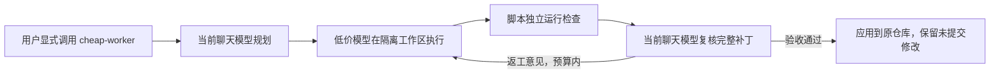

# 在 Codex 聊天中使用低价执行模型

当前聊天中选择的模型负责规划、决定委派范围、复核与验收；这个框架只调用一个外部低价执行模型。无需另填高级模型的 API，也不会修改 Codex 的登录、模型或供应商配置。

显式使用 `$cheap-worker` 后，聊天模型会按技能规则自动选择合适的实现步骤调用执行器。普通聊天不会自动启用它；启用范围限于当前任务。执行器通过独立 API 工作，不是在 Codex 中切换当前聊天模型。聊天额度与执行 API 费用分别计算。



## 现在怎么使用

本机技能已安装到当前官方文档中的用户目录 `~/.agents/skills/cheap-worker`，并保留 `~/.codex/skills/cheap-worker` 兼容链接；两者都指向本目录下的同一个 `skills/cheap-worker`。框架留在当前位置即可；新建聊天或刷新 IDE 的技能列表后，输入：

```text
$cheap-worker 帮我完成 /home/ww/某个项目 中的这个任务：……
由你规划并验收，将适合的实现步骤交给低价模型。
```

通常无需手工创建任务文件、选择执行模型、写返工命令：这些由当前聊天模型按技能完成。使用时仍应在 Codex 中选择你希望负责规划和验收的高级模型；技能不会自动升级当前聊天模型。

**你只需先填写本目录 `.env` 的三个值：**

```dotenv
EXECUTOR_BASE_URL=https://你的供应商/API根路径
EXECUTOR_API_KEY=你的执行模型密钥
EXECUTOR_MODEL=供应商实际支持的模型ID
```

BASE_URL 是 API 根路径，例如供应商要求的 `/v1`；不要追加 `/chat/completions` 或 `/responses`。不要将 `.env` 内容发送到聊天。

随后检查 `config.yaml` 的执行协议：

```yaml
roles:
  executor:
    env_prefix: EXECUTOR
    api: chat_completions
    max_output_tokens: 8000
    chat_token_parameter: max_tokens
    request_options: {}
```

支持 `chat_completions` 与 `responses`。Chat 供应商要求新参数时，可将 `chat_token_parameter` 改成 `max_completion_tokens`。供应商模型需要支持工具调用与工具结果续写；仅支持普通文本的接口不适用。

离线检查配置：

```bash
cd /home/ww/multi_model_codex
bash run.sh doctor
```

这个命令不联网，也不验证余额、模型是否存在或工具兼容性。填写好配置后，可执行一次真实接口检查：

```bash
bash run.sh doctor --probe
```

`--probe` 会产生两次执行模型 API 请求及费用。默认不自动执行它。当前模板仍为占位信息，尚未验证真实供应商。

## 安装与迁移

本机 Python 虚拟环境和技能链接已准备好。搬迁目录或在另一台机器安装时运行：

```bash
bash scripts/setup.sh
```

安装固定依赖、保留现有 `.env`、安装当前用户技能。可单独重装链接：

```bash
python3 scripts/install_skill.py
```

默认创建 `CODEX_HOME/skills`（未设置时为 `~/.codex/skills`）及当前官方文档的 `~/.agents/skills` 用户目录链接；不会覆盖同名的其他技能。仅需安装到指定目录时可使用：

```bash
python3 scripts/install_skill.py --skills-dir ~/.agents/skills
```

本机 Codex `skills/list` 已实际识别此用户技能（enabled=true），证据见 `runs/skill-discovery.json`。技能源在 [skills/cheap-worker/SKILL.md](skills/cheap-worker/SKILL.md)，`agents/openai.yaml` 设置 `allow_implicit_invocation: false`。安装后正在进行的聊天可能尚未加载它，需新建聊天或刷新技能列表。

这次改造已从活动配置和 `.env` 中去除规划/复核 API，保留执行端值并迁移为 `EXECUTOR_*`。旧 `SOL_*` / `DEEPSEEK_*` 不再作为配置入口；旧三阶段命令及 `--dry-run` 不再使用。此前构建报告与 `runs/` 历史记录仅作为旧架构证据保留。

## 实际执行约束

聊天模型先编写仓库外的任务契约，提供必要上下文、固定验收标准、允许修改的文件或目录，以及适合项目的检查命令。执行器只能调用受限文件工具、日志读取和这些具名检查；无任意 shell 工具。

每次任务默认把目标 Git 工作区复制到运行目录，包含用户已有的未提交修改，但排除凭据、`.git`、虚拟环境和运行日志。复制品内部创建一次仅供基线比较的临时提交，执行器不会修改源仓库，也不会创建或切换源仓库分支。`execution.mode: branch` 可选择更严格的 detached worktree 模式；它仍不创建命名分支，但要求源仓库干净。没有 Git 或没有初始提交的目录仍由聊天模型直接处理。

开始前可先把当前干净分支推送到其 upstream：

```bash
bash run.sh push --repo /absolute/project
bash run.sh execute --push-before --repo /absolute/project --contract /outside/project/task.json
```

`--push-before` 只执行不带 `--force` 的普通 `git push`，要求当前分支有 upstream 且工作区干净。默认不自动 push，因为 push 是外部仓库写操作；技能应在当前聊天已获得授权且用户确认目标 remote 后使用它。复制模式允许未提交修改，但这时 preflight push 会拒绝，避免把未提交内容误认为已备份。

独立检查通过后只生成 `READY_FOR_REVIEW`，并不代表验收完成。当前聊天模型必须检查完整补丁、实际日志和每条验收标准，再写审阅记录。应用前脚本再次校验内容摘要、源仓库状态和补丁一致性；复核后文件发生变化、检查失败、缺少标准或原仓库新增修改都会阻止自动应用。

默认首轮后最多返工 2 次，累计 24 次逻辑模型请求；默认关闭 SDK 自动重试。可在 `workflow` 调整预算、超时和上下文上限。请求数不是金额上限；实际 token 与费用由供应商决定。达到预算或持续无进展时由聊天模型接手，不循环新建任务绕过限制。

受限工具会拒绝密钥路径、符号链接路径及范围外修改；AGENTS.md、CI 等文件只能读取。任务运行文件保存在权限受限的 `runs/` 目录，已知 API key 会脱敏。运行记录包含任务上下文、源码片段及补丁，需按项目数据要求保管。

Git worktree 和工具限制不是操作系统沙箱。检查命令仍以本机权限运行项目代码，应由聊天模型根据用户授权确定可信的测试/构建命令。子进程默认不继承 API key、HOME、PYTHONPATH 和 ROS 环境；ROS 工作区需使用明确加载所需环境的可信检查脚本。没有在本次改造中运行硬件、修改 ROS 项目或更改 Codex 全局模型配置。

## 可查看或手动运行的接口

详细契约格式与验收记录见 [技能调用约定](skills/cheap-worker/references/workflow.md)。常用命令：

```bash
bash run.sh push --repo /absolute/project
bash run.sh execute --repo /absolute/project --contract /outside/repo/task.json
bash run.sh inspect --run /absolute/run
bash run.sh rework --run /absolute/run --feedback-file /outside/repo/feedback.txt
bash run.sh apply --run /absolute/run --review-file /outside/repo/review.json
bash run.sh rollback --run /absolute/run
```

全局选项如 `--config`、`--env-file`、`--runs-dir` 放在子命令前面。返工读取运行目录保存的固定契约、配置和预算，不随意改变验收标准。`inspect` / `apply` 不调用 API；`apply` 只应用已验收补丁，不提交、推送、部署。它校验审阅记录的内容，无法从密码学上证明记录由哪种模型撰写；聊天模型必须自行复核，不让执行模型代填。

每次运行主要产物：

| 文件 | 内容 |
| --- | --- |
| `summary.json` / `summary.md` | 状态、工作区、累计预算、检查结果与摘要 |
| `contract.json` / `config.yaml` | 固定任务和执行配置，不含 API key |
| `candidate.patch` | 最近完成检查的候选补丁，含新增文件 |
| `round-N/executor-report.txt` | 执行模型自述，不能替代验证 |
| `round-N/verification.json` / `check_*.log` | 脚本独立执行的真实检查结果 |
| `round-N/events.jsonl` / `snapshot.json` | 调用记录及复核快照 |
| `chat-review.json` | 应用时记录的聊天模型验收意见 |
| `worktree/` | 保留的复制工作区或 detached worktree，便于继续审查 |

失败或中断可能留下旧轮次候选补丁，只以当前状态及匹配摘要为准。复制模式的运行目录可直接删除；branch 模式的 detached worktree 需要用 Git worktree 命令检查并清理，不自动删除未验收工作。`rollback` 只在源仓库仍保持应用后精确状态时反向应用候选补丁，源文件被再次修改后会拒绝自动恢复。

## 离线验证

不需要真实 API key：

```bash
env -u PYTHONPATH -u PYTHONHOME .venv/bin/python -m unittest discover -s tests -v
env -u PYTHONPATH -u PYTHONHOME .venv/bin/python scripts/offline_demo.py
```

演示使用 localhost 假供应商，经过真实 SDK、文件工具、复制工作区、实际单元测试、失败返工和应用/恢复到源仓库的完整路径；模拟聊天反馈与验收记录，不代表真实高/低模型效果。记录会保留在 `runs/skill-offline-demo-*`。

27 项自动化测试、技能格式校验和本地失败返工演示均已通过。本次结果与限制记录在 [聊天式执行器改造报告](docs/build-reports/2026-10-19-聊天技能式低价模型执行器改造.md)。技能的显式调用与脚本组织依据 [OpenAI 官方技能文档](https://learn.chatgpt.com/docs/build-skills.md)；本机安装兼容当前 `skill-creator` 的目录规则和官方文档的 `.agents/skills` 用户目录。
